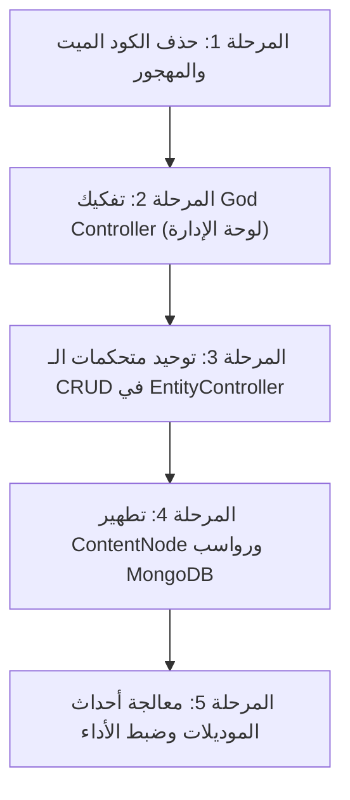

# 🏛️ تقرير التحليل المعماري الشامل والعميق لمجلد `app/`
**المشروع:** EntityPostgre (الأرشيف الرقمي والكيانات التراثية)  
**تاريخ التحليل:** أكتوبر 2026  
**نطاق الفحص:** الفحص الشامل لجميع الطبقات البرمجية في مجلد `app/` (Controllers, Models, Services, Observers, Traits, Enums, Middleware, Repositories, Commands, Requests).  
**حالة الاختبارات الحالية:** ✅ **603 اختبارات ناجحة بالكامل** (توفّر شبكة أمان مثالية لأي إعادة هيكلة).

---

## 📑 الفهرس التنفيذي
1. [الملخص التنفيذي والإحصائيات العامة](#1-الملخص-التنفيذي-والإحصائيات-العامة)
2. [المحور الأول: الكود الميت والطبقات المهجورة (Dead & Abandoned Code)](#2-المحور-الأول-الكود-الميت-والطبقات-المهجورة)
3. [المحور الثاني: رواسب الترحيل من MongoDB إلى PostgreSQL (Migration Relics)](#3-المحور-الثاني-رواسب-الترحيل-من-mongodb-إلى-postgresql)
4. [المحور الثالث: طبقة المتحكمات وتفكك المعمارية (Controllers Architecture & God Classes)](#4-المحور-الثالث-طبقة-المتحكمات-وتفكك-المعمارية)
5. [المحور الرابع: الخدمات وطبقة الأعمال وتكرار المنطق (Services Layer Duplication)](#5-المحور-الرابع-الخدمات-وطبقة-الأعمال-وتكرار-المنطق)
6. [المحور الخامس: دورة حياة النماذج والمراقبين وحيل الالتفاف (Observers & Lifecycle Hacks)](#6-المحور-الخامس-دورة-حياة-النماذج-والمراقبين-وحيل-الالتفاف)
7. [المحور السادس: تناقضات الدومين والاصطلاحات والمسميات (Domain & Taxonomy Discrepancies)](#7-المحور-السادس-تناقضات-الدومين-والاصطلاحات-والمسميات)
8. [المحور السابع: اختناقات الأداء والاستعلامات (Performance & Database Bottlenecks)](#8-المحور-السابع-اختناقات-الأداء-والاستعلامات)
9. [خارطة الطريق المقترحة لإعادة الهيكلة والتنظيف (Refactoring Roadmap)](#9-خارطة-الطريق-المقترحة-لإعادة-الهيكلة-والتنظيف)

---

## 1. الملخص التنفيذي والإحصائيات العامة

بعد رحلة بناء طويلة وشاملة، تطور المشروع من بداياته مع MongoDB إلى قاعدة بيانات PostgreSQL العلائقية مع حقول JSONB، ومر بمراحل تجريبية عديدة (بناء الاستوديو، بناء أنظمة القراءة، تصدير الكتب، إدارة الصلاحيات RBAC).

### توزيع الكود في مجلد `app/`:
| الطبقة | عدد الملفات | إجمالي الأسطر التقريبي | الحالة والتقييم |
| :--- | :---: | :---: | :--- |
| **Http/Controllers** | 47 ملفاً | ~6,150 سطر | يعاني من وجود "God Controller" وتكرار بين Web و API |
| **Models** | 29 ملفاً | ~2,410 سطر | يحتوي على 6 موديلات توافق قديمة وتضخم في `ContentNode` |
| **Services** | 9 ملفات | ~1,850 سطر | خدمات مهجورة بالكامل وخدمات مكررة الصلاحيات |
| **Http/Requests** | 22 ملفاً | ~1,100 سطر | ملفات غير مستخدمة وتكرار بين Store و Update |
| **Observers & Policies** | 5 ملفات | ~560 سطر | تضارب أحداث مع Model Booting واستخدام `flushEventListeners` |
| **Console/Commands** | 8 ملفات | ~3,000 سطر | أوامر مزامنة مكررة وأوامر استيراد ضخمة |
| **Repositories** | 1 ملف | ~205 سطر | **مهجور بالكامل** وغير مستخدم في أي مكان |
| **Traits & Helpers & Enums** | 8 ملفات | ~1,200 سطر | Enums ممتازة، مع تباين طفيف في أسماء العلاقات |
| **الإجمالي** | **~129 ملفاً** | **~16,500 سطر** | **جاهز لعملية تنظيف شاملة تحذف 20-25% من الكود الزائد** |

---

## 2. المحور الأول: الكود الميت والطبقات المهجورة

وجد التحليل عدداً من الملفات والطبقات التي أُنشئت في مراحل سابقة ولم تعد مستخدمة في أي مسار أو خدمة، وبقيت فقط عبئاً صيانياً:

### 1. طبقة الـ Repositories المهجورة بالكامل:
- [`app/Repositories/EntityBaseRepository.php`](file:///home/a/PhpstormProjects/EntityPostgre/app/Repositories/EntityBaseRepository.php) (206 أسطر):
  - كُتب كطبقة مستودع للبحث عن الكيانات بالـ ID والـ Slug.
  - **الواقع:** لا يوجد أي Controller أو Service يستدعيه أو يحقنه! تم تجاوزه كلياً بالاستعلام المباشر عبر Eloquent. لا يستدعيه سوى ملف اختبار وحدة معزول.

### 2. خدمات مهجورة (Dead Services):
- [`app/Services/EntityRelationService.php`](file:///home/a/PhpstormProjects/EntityPostgre/app/Services/EntityRelationService.php) (285 سطراً):
  - خدمة كاملة لإدارة علاقات الـ Tags والـ Categories (`attach`, `detach`, `sync`).
  - **الواقع:** كل المتحكمات في المشروع تستخدم علاقات Eloquent المباشرة (`$entity->tags()->sync(...)` أو عبر `EntityControllerHooks`). هذه الخدمة معطلة بنسبة 100% ولا تُستدعى إلا في اختبار وحدتها!

### 3. طلبات FormRequests مهجورة:
- [`app/Http/Requests/StoreEntityRequest.php`](file:///home/a/PhpstormProjects/EntityPostgre/app/Http/Requests/StoreEntityRequest.php) (83 سطراً)
- [`app/Http/Requests/UpdateEntityRequest.php`](file:///home/a/PhpstormProjects/EntityPostgre/app/Http/Requests/UpdateEntityRequest.php) (57 سطراً)
  - كُتبت كطلبات عامة لـ Entity، لكن كل نوع كيان (`Book`, `Audio`, `Video`, `Manuscript`) يملك FormRequest خاصاً به. هذان الملفان غير مستخدمين في أي مسار أو متحكم.

### 4. ملفات نسخ احتياطية وفئات مهملة في مجلد Controllers:
- [`app/Http/Controllers/AuthorController.php.backup`](file:///home/a/PhpstormProjects/EntityPostgre/app/Http/Controllers/AuthorController.php.backup):
  - ملف احتياطي كامل تم ارتكابه (commit) في مستودع Git بالخطأ داخل مجلد الكود الحي!
- [`app/Http/Controllers/SuperAdminDashboardController.php`](file:///home/a/PhpstormProjects/EntityPostgre/app/Http/Controllers/SuperAdminDashboardController.php) (11 سطراً):
  - فئة فارغة تحمل تعليق `@deprecated Use AdminDashboardController instead`. مسار `routes/web.php` يشير مباشرة إلى `AdminDashboardController`.
- [`app/Http/Controllers/EditorTestController.php`](file:///home/a/PhpstormProjects/EntityPostgre/app/Http/Controllers/EditorTestController.php) (61 سطراً):
  - مسار ومتحكم اختباري تجريبي (`/editor-test`) يحتوي على بيانات وهمية Hardcoded (`كتاب اختبار التعددية`, روابط `example.com`).

### 5. أكواد معلّقة ومتروكة (Commented Out Code):
- في [`app/Traits/HasPolymorphicRelations.php`](file:///home/a/PhpstormProjects/EntityPostgre/app/Traits/HasPolymorphicRelations.php#L62-L98):
  - توجد علاقات كاملة معلّقة بتعليقات PHP (`reviews()`, `favourites()`, `searchTerms()`, `views()`).

---

## 3. المحور الثاني: رواسب الترحيل من MongoDB إلى PostgreSQL

كان المشروع في أصله مبنياً على MongoDB، ثم رُحّل بالكامل إلى PostgreSQL ليستخدم نموذجاً موحداً هو [`ContentNode`](file:///home/a/PhpstormProjects/EntityPostgre/app/Models/ContentNode.php). نتج عن ذلك طبقة ضخمة من التوافقية المؤقتة التي استمرت لفترة أطول من اللازم:

### 1. موديلات الـ Adapters الصورية (Compatibility Dummy Models):
توجد 6 موديلات كاملة ترث من `ContentNode` ولا تفعل شيئاً سوى ضبط الـ `type` ومحولات المفاتيح القديمة:
1. [`app/Models/EntityContent.php`](file:///home/a/PhpstormProjects/EntityPostgre/app/Models/EntityContent.php) (فارغ تماماً، فقط `class EntityContent extends ContentNode`)
2. [`app/Models/BookChild.php`](file:///home/a/PhpstormProjects/EntityPostgre/app/Models/BookChild.php)
3. [`app/Models/ManuscriptChild.php`](file:///home/a/PhpstormProjects/EntityPostgre/app/Models/ManuscriptChild.php)
4. [`app/Models/ManuscriptPage.php`](file:///home/a/PhpstormProjects/EntityPostgre/app/Models/ManuscriptPage.php) (نسخة طبق الأصل 100% من `ManuscriptChild`!)
5. [`app/Models/AudioSegment.php`](file:///home/a/PhpstormProjects/EntityPostgre/app/Models/AudioSegment.php)
6. [`app/Models/VideoSegment.php`](file:///home/a/PhpstormProjects/EntityPostgre/app/Models/VideoSegment.php)

> **المشكلة:** وجود 6 نماذج تمثل نفس الجدول `content_nodes` يُربك المطورين الجدد، ويُحدث ازدواجية في الاستعلامات، ويجبر كود الـ Morph Map على تسجيل مسميات زائدة (`book_child`, إلخ).

### 2. تضخم نموذج [`ContentNode.php`](file:///home/a/PhpstormProjects/EntityPostgre/app/Models/ContentNode.php) (461 سطراً):
يحتوي هذا النموذج على تشوهات ناتجة عن التوافق مع MongoDB:
- **محاكاة `_id`:** تجاوز دوال Eloquent الأساسية (`getAttribute`, `setAttribute`) لدعم خاصية `_id` الخاصة بـ MongoDB!
- **ازدواجية تمثيل المحتوى:** النموذج يدعم في آن واحد:
  - `content_html` و `plain_text` و `content_json` و `content_blocks` و `json_content` و `content`!
  - 6 خصائص مختلفة للقراءة والكتابة لنفس المحتوى النصي.
- **خصائص وهمية مشتتة في `metadata`:**
  - `start_time`, `end_time`, `duration`, `folio_number`, `image_url`, `page_number`, `last_editor_id`, `transcription_status`.
  - كل واحدة منها تملك `getter` و `setter` يدوي يقرأ ويكتب في مصفوفة الـ JSONB `metadata`.
- **نظام نسخ مزدوج (Dual Versioning):**
  - النموذج يملك دالة `createVersion()` لحفظ تاريخ التعديلات داخل مصفوفة `metadata->versions` في نفس السجل، بينما يمتلك المشروع جدولاً وموديلاً كاملاً ومستقلاً باسم [`Version.php`](file:///home/a/PhpstormProjects/EntityPostgre/app/Models/Version.php).

---

## 4. المحور الثالث: طبقة المتحكمات وتفكك المعمارية

طبقة الـ Controllers هي الأكثر تضخماً واحتياجاً لإعادة الهيكلة:

### 1. المتحكم الوحش (God Controller): [`AdminDashboardController.php`](file:///home/a/PhpstormProjects/EntityPostgre/app/Http/Controllers/AdminDashboardController.php) (748 سطراً):
دالة `index()` وحدها تحتوي على ما يقارب **600 سطر برمجي** وتقوم بالتالي في كل طلب صفحة:
- حساب إحصائيات 16 جدولاً وقمع الاستوديو (Funnel stats).
- استعلام أحدث 10 أنشطة + أحدث 50 مستخدماً.
- ترقيم وبناء مصفوفات مخصصة لـ 6 أنواع أصول (كتب، مخطوطات، صوتيات، مرئيات، مؤلفين، ناشرين).
- استعلام وتجميع المحذوفات الناعمة (Soft Deleted) من 5 جداول مختلفة بالـ `concat`.
- فحص دوري لهيكل الجداول عبر `Schema::getColumnListing($table)` في كل طلب مراراً وتكراراً (مما يضيف overhead استعلامات بيانات وصفية على PostgreSQL).
- حشو بيانات شكلية وتجريبية داخل الاستعلامات (مثل: `'ممتازة 95%'`, `'1.4 GB'`, `'مكتبة كوبريلي'`, `'باقي 29 يوماً'`).

### 2. تفكك معمارية الـ CRUD بين المتحكمات:
تم بناء [`EntityController.php`](file:///home/a/PhpstormProjects/EntityPostgre/app/Http/Controllers/EntityController.php) كـ Base Controller بنمط Template Method لحل التكرار في أكثر من 15 متحكماً، ولكن التطبيق جاء مجزأً:
- **المتحكمات التي ورثته بنجاح ونظافة (10 متحكمات):**
  - `BookController`, `ManuscriptController`, `AudioController`, `VideoController`, `CategoryController`, `TagController`, `TopicController`, `AuthorController`, `PublisherController`, `SeriesController`.
- **المتحكمات التي تجاهلته وكررت كود الـ CRUD بالكامل (6 متحكمات):**
  - [`BookerController.php`](file:///home/a/PhpstormProjects/EntityPostgre/app/Http/Controllers/BookerController.php) (126 سطراً)
  - [`CollectionController.php`](file:///home/a/PhpstormProjects/EntityPostgre/app/Http/Controllers/CollectionController.php) (141 سطراً)
  - [`ShelfController.php`](file:///home/a/PhpstormProjects/EntityPostgre/app/Http/Controllers/ShelfController.php) (119 سطراً)
  - [`LanguageController.php`](file:///home/a/PhpstormProjects/EntityPostgre/app/Http/Controllers/LanguageController.php) (120 سطراً)
  - [`CommentController.php`](file:///home/a/PhpstormProjects/EntityPostgre/app/Http/Controllers/CommentController.php) (108 سطور)
  - [`NoteController.php`](file:///home/a/PhpstormProjects/EntityPostgre/app/Http/Controllers/NoteController.php) (108 سطور)
  جميعها تكرر دوال `index`, `create`, `store`, `edit`, `update`, `destroy`, `bulkDestroy` يدوياً!

### 3. الازدواجية والانفصال في متحكمات الـ API (`app/Http/Controllers/Api/*`):
توجد 15 فئة في مجلد `Api`:
- **غياب التحقق (No Validation):** دالة `store` و `update` تأخذ `$request->all()` مباشرة وتمررها لـ `EntityManagerService` دون FormRequest ودون قواعد تحقق!
- **حقن تبعيات ميت (Dead Dependency Injection):**
  - في `Api/BookController`, `Api/AudioController`, `Api/VideoController`, `Api/ManuscriptController`:
    يتم حقن `EntityQueryService $query` في الـ `__construct` ولا يُستخدم نهائياً في أي دالة داخل الكلاس!
- **كود استجابة غير قياسي:** استخدام `210` كرمز استجابة في `response()->json(..., 210)` بدلاً من المعيار القياسي `201 Created`.

### 4. التكرار الصريح في البث المباشر:
- في [`MediaStreamController.php`](file:///home/a/PhpstormProjects/EntityPostgre/app/Http/Controllers/MediaStreamController.php):
  دالة `streamVideo()` ودالة `streamAudio()` متطابقتان بنسبة **95%** حرفاً بحرف (معالجة HTTP Range، قراءة الـ chunks، الترويسات 206/200). يمكن دمجهما في دالة واحدة خاصة تأخذ المسار والنوع.

### 5. تداخل متحكمات المحرر والاستوديو:
- [`UnifiedEditorController.php`](file:///home/a/PhpstormProjects/EntityPostgre/app/Http/Controllers/UnifiedEditorController.php) (428 سطراً)
- [`BookContentController.php`](file:///home/a/PhpstormProjects/EntityPostgre/app/Http/Controllers/BookContentController.php) (107 سطور)
- [`ContentNodeController.php`](file:///home/a/PhpstormProjects/EntityPostgre/app/Http/Controllers/ContentNodeController.php) (72 سطراً)
  هناك تداخل في مسؤوليات الحفظ (`save` vs `updateValidation`) واسترجاع النسخ (`restoreVersion` مكررة في متحكمين).

---

## 5. المحور الرابع: الخدمات وطبقة الأعمال وتكرار المنطق

### 1. خدمات الاستعلام ومخاطر استنزاف الذاكرة:
- [`app/Services/EntityQueryService.php`](file:///home/a/PhpstormProjects/EntityPostgre/app/Services/EntityQueryService.php):
  - دالة `paginate()` تقوم بجلب **جميع** السجلات من الكتب والمرئيات والصوتيات والمخطوطات دفعة واحدة في الذاكرة عبر `$this->queryAllEntities(fn($q) => $q)`، ثم تدمج الـ Collections وتقتطع منها بالـ `slice()`.
  - **الخطر:** هذا النمط ينفجر في بيئات الإنتاج فور وصول عدد السجلات لبضعة آلاف، مسبباً Memory Exhaustion.

### 2. تشتت خدمات المحتوى بين الكتاب والكيان الموحد:
- [`app/Services/BookContentService.php`](file:///home/a/PhpstormProjects/EntityPostgre/app/Services/BookContentService.php) (87 سطراً):
  - خُصصت للكتاب فقط (`addChild`, `getHierarchy`, `addBlock`, `updateOrder`).
- [`app/Services/EntityContentService.php`](file:///home/a/PhpstormProjects/EntityPostgre/app/Services/EntityContentService.php) (469 سطراً):
  - تقوم بنفس المهام لجميع الكيانات الموحدة.
  - وجود الخدمتين معاً يخلق ازدواجية في نقطة الحقيقة (Single Source of Truth).

---

## 6. المحور الخامس: دورة حياة النماذج والمراقبين وحيل الالتفاف

### 1. حيلة `flushEventListeners()` في مقدم الخدمة:
في [`app/Providers/AppServiceProvider.php`](file:///home/a/PhpstormProjects/EntityPostgre/app/Providers/AppServiceProvider.php#L70-L73):
```php
Book::flushEventListeners();
Video::flushEventListeners();
Audio::flushEventListeners();
Manuscript::flushEventListeners();
```
- **لماذا وُضعت؟** لأن الموديلات ترث من [`Entity.php`](file:///home/a/PhpstormProjects/EntityPostgre/app/Models/Entity.php) الذي يملك في دالة `booted()` أحداث توليد الـ `slug` وحذف الـ `nodes`. وفي الوقت ذاته، يقوم `AppServiceProvider` بتسجيل 4 مراقبين (`EntityLifecycleObserver`, `EntityAuditObserver`, `EntityCacheObserver`, `EntityContentObserver`) تقوم بنفس المهام تماماً!
- **النتيجة:** لتفادي تكرار تنفيذ الأحداث، قام المطور بمسح أحداث Eloquent بالكامل عبر `flushEventListeners()`، وهي حيلة (Code Smell) تدل على تضارب بين الـ Model Hooks والـ Observers.

### 2. ازدواجية تسجيل الأنشطة (Duplicate Activity Logging):
- [`EntityAuditObserver.php`](file:///home/a/PhpstormProjects/EntityPostgre/app/Observers/EntityAuditObserver.php) يقوم تلقائياً بإنشاء سجل في جدول `activities` عند أحداث `created`, `updated`, `deleted`, `restored`.
- وفي نفس الوقت، تقوم خدمة [`EntityManagerService.php`](file:///home/a/PhpstormProjects/EntityPostgre/app/Services/EntityManagerService.php#L88) باستدعاء `logActivity` يدوياً لإنشاء نفس السجل!

### 3. ازدواجية الحذف التعاقبي (Cascading Deletes):
- في `Entity.php` (السطر 49): `static::deleting` يقوم بحذف الـ `nodes()`.
- وفي [`EntityContentObserver.php`](file:///home/a/PhpstormProjects/EntityPostgre/app/Observers/EntityContentObserver.php#L12): `deleted` و `forceDeleted` يقومان أيضاً بحذف الـ `nodes()`.

---

## 7. المحور السادس: تناقضات الدومين والاصطلاحات والمسميات

### 1. إشكالية `Booker` مقابل `Author`:
- تم إنشاء جدول وموديل [`Booker.php`](file:///home/a/PhpstormProjects/EntityPostgre/app/Models/Booker.php) ومتحكم [`BookerController.php`](file:///home/a/PhpstormProjects/EntityPostgre/app/Http/Controllers/BookerController.php).
- في الواجهة العربية يُترجم إلى **"مساهم"** (Contributor / المحقق / المراجع / المدقق).
- تسميته البرمجية بـ `Booker` تسمية غير قياسية ومربكة، وتكرر نفس بنية [`Author.php`](file:///home/a/PhpstormProjects/EntityPostgre/app/Models/Author.php) (كلاهما Polymorphic Many-to-Many مع الأصول عبر `authorable` و `bookable`).

### 2. تضارب مسميات الجمع والمفرد في العلاقات:
- في [`TaxonomyRelationships.php`](file:///home/a/PhpstormProjects/EntityPostgre/app/Traits/TaxonomyRelationships.php#L28):
  العلاقة تسمى `public function audio(): MorphToMany` (بالمفرد).
- بينما في `Author` و `Booker` و `AdminDashboardController`:
  العلاقة تسمى `audios()` (بالجمع `withCount(['books', 'videos', 'audios', 'manuscripts'])`).
- هذا التباين يتسبب في استثناءات مفاجئة عند طلب الـ Counts لبعض التصنيفات.

### 3. التناقض بين الـ Enum والخدمة:
- في [`app/Enums/ContentNodeType.php`](file:///home/a/PhpstormProjects/EntityPostgre/app/Enums/ContentNodeType.php):
  تم حصر الحالات القياسية المسموحة (`sub-book`, `part`, `bab`, `chapter`, `masalah`, `page`, `section`, `folio`, `segment`, `track`, `marker`, `scene`, `shot`).
- في [`app/Services/EntityContentService.php`](file:///home/a/PhpstormProjects/EntityPostgre/app/Services/EntityContentService.php#L19):
  تم تعريف مصفوفة يدوية `$allowedTypes` أُضيف فيها نوع `'paragraph'` الذي لا وجود له في الـ Enum!

---

## 8. المحور السابع: اختناقات الأداء والاستعلامات

1. **استعلامات البنية الوصفية المتكررة (Metadata Schema Overhead):**
   - في `AdminDashboardController`، تكرار استدعاء `Schema::getColumnListing($table)` يفحص جداول PostgreSQL في كل دورة طلب بدل حفظ قائمة الأعمدة كثوابت (Constants) في الموديلات.
2. **مشكلة N+1 في بناء مسار الهرمية (Breadcrumbs):**
   - في [`app/Models/Category.php`](file:///home/a/PhpstormProjects/EntityPostgre/app/Models/Category.php#L91):
     دالة `getHierarchyPath()` تنفذ حلقة `while ($current)` تستعلم الأب تلو الآخر بشكل متسلسل بدلاً من استعلام الشجرة دفعة واحدة أو حفظ مسار مسطح (`path` / `materialized path`).
3. **حلقة الاستعلامات المتسلسلة في توليد الـ Slugs:**
   - في [`app/Helpers/SlugHelper.php`](file:///home/a/PhpstormProjects/EntityPostgre/app/Helpers/SlugHelper.php#L64):
     دالة `uniqueSlug` تنفذ `while ($existsQuery($slug))`، مما يطلق استعلاماً تلو الآخر عند وجود تعارضات حتى يصل لرقم فريد.

---

## 9. خارطة الطريق المقترحة لإعادة الهيكلة والتنظيف

بناءً على هذا التشخيص الدقيق، نوصي بأن تتم خطة التنظيف وإعادة الهيكلة عبر **5 مراحل تدريجية ومضبوطة بالكامل بواسطة الـ 603 اختبارات القائمة**:



### 🔹 المرحلة 1: حذف الكود الميت والمهجور (Safe Dead Code Pruning)
- حذف الملف الاحتياطي المرتكب بالخطأ: `AuthorController.php.backup`.
- حذف الفئة المهجورة `SuperAdminDashboardController.php`.
- حذف `EntityBaseRepository.php` واختباره المعزول.
- حذف `EntityRelationService.php` واختباره المعزول.
- حذف `StoreEntityRequest.php` و `UpdateEntityRequest.php`.
- إزالة الأكواد المعلقة في `HasPolymorphicRelations.php`.

### 🔹 المرحلة 2: تفكيك وحقن لوحة الإدارة (`AdminDashboardController`)
- إنشاء خدمات إحصائية مخصصة (مثل `DashboardStatsService` و `DashboardAssetQueryService`).
- نقل استعلامات الأصول والترقيم والتصفية من الـ Controller إلى خدمات مخصصة.
- إزالة استدعاءات `Schema::getColumnListing` والاستعاضة عنها بفلاتر بيضاء معرّفة مسبقاً (Whitelisted attributes).
- استبدال القيم الشكلية الوهمية (Mocked Strings) بحقول حقيقية أو إزالتها.

### 🔹 المرحلة 3: توحيد متحكمات الـ CRUD ومواءمة الـ API
- إخضاع المتحكمات الستة المتخلفة (`Booker`, `Collection`, `Shelf`, `Language`, `Comment`, `Note`) للوراثة من `EntityController`.
- توحيد معايير الـ API Controllers: إضافة التحقق الصحيح (FormRequests) واستخدام رموز الـ HTTP القياسية (`201` بدلاً من `210`).
- دمج دالتي `streamVideo` و `streamAudio` في دالة موحدة بـ `MediaStreamController`.

### 🔹 المرحلة 4: تطهير وتوحيد شجرة المحتوى (`ContentNode`)
- إزالة طبقات التوافق القديمة لـ MongoDB:
  - التخلص من تجاوزات `_id` في `ContentNode`.
  - تحويل نماذج التوافق الستة (`BookChild`, `ManuscriptChild`, إلخ) إلى Scopes أو علاقات مباشرة على `ContentNode`.
- توحيد واجهات المحتوى: اعتماد `content_html` و `content_json` و `plain_text` بشكل صريح وإلغاء المسميات البديلة (`content`, `html_content`, `content_blocks`).
- حسم تبعية النسخ التاريخية: الاعتماد على جدول `versions` الموحد بدلاً من مصفوفة `metadata->versions` المدمجة.

### 🔹 المرحلة 5: ضبط أحداث دورة الحياة ومشاكل الأداء
- حل مشكلة `flushEventListeners()`: إما اعتماد الـ Observers بالكامل أو اعتماد Model Hooks، وإزالة الازدواجية في تسجيل الأنشطة والحذف التعاقبي.
- تصحيح خطأ الذاكرة في `EntityQueryService::paginate()`.
- توحيد مسمى علاقة الوسائط المتعددة (إما `audio` أو `audios` في كل مكان).
- مزامنة الـ Enum `ContentNodeType` مع الخدمات وإزالة أي حالات مضافة يدوياً.

---
**الخلاصة:**  
المشروع مبني بأسس قوية جداً بدليل نجاح جميع الاختبارات الـ 603، والفرصة الآن مثالية لإنجاز عملية تنظيف معمارية راقية تخفف من تعقيد الصيانة وتجعل البنية التحتية للمشروع في قمة الكفاءة والوضوح.
